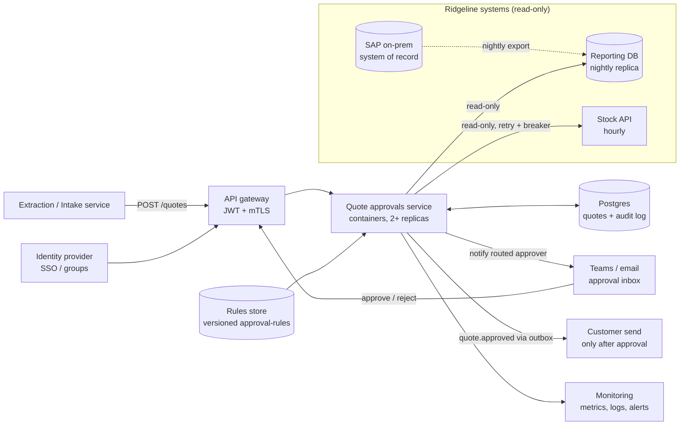

# Ridgeline Quote Approvals

A NestJS service that takes draft quotes from the extraction (Intake) team, prices them from the read-only reporting snapshot, checks stock through the stock API, and routes each quote to the right approver right away, applying the backup when someone is out. A person approves every quote: a quote specialist always signs off first. Every action is written to an append-only audit log. Nothing writes to SAP.

## Repository

https://github.com/aristidescc/ridgeline-pricing-challenge

## How to Run

Requirements: Node 22+ (tested on 24), pnpm 10, Python 3.9+ (only for the mock stock API).

**Setup** (every variable is optional; defaults are documented in `.env.example`):

```bash
pnpm install
cp .env.example .env
```

**1. Mock stock API** on :8080 (10% of calls return 503, 150 ms latency). Use `MOCK_FAILURE_RATE=0` for a calm run:

```bash
pnpm run stock:mock
```

**2. Process the 10 sample drafts** → `outputs/routing_results.json` (+ `outputs/audit_log.json`). This builds, then runs the batch at the policy time `AS_OF=2026-10-12T09:30-05:00`. Add `STOCK_CLIENT=fixture` to run offline without the mock:

```bash
pnpm run process
```

**3. Start the HTTP API** on :3000 (fixed `AS_OF` so out-of-office dates match the sample data). Add `APP_DB_PATH=:memory:` for a throwaway store:

```bash
pnpm run start:demo
```

**4. Tests.** Unit tests cover pricing, each routing tier, the backup approver, duplicates, retries, stock flags and the service flow. The e2e test covers 401/403, 400, intake → specialist → approver, 409 and 501:

```bash
pnpm test
pnpm run test:e2e
pnpm run build && pnpm run lint
```

API (send the stub identity in `x-user-id`: `intake`, specialists `S01`–`S03`, approvers `U01`–`U05`):

| Method | Path | Who |
|---|---|---|
| `POST` | `/quotes` | `intake` (Intake service): prices, routes and stores a draft. Returns 201 for a new draft, 200 when the same `draft_id` is sent again |
| `GET` | `/quotes?status=&approver_id=` | any known user |
| `GET` | `/quotes/:id` · `/quotes/:id/audit` | any known user |
| `POST` | `/quotes/:id/approve` `{comment?}` | specialist first, then only the routed approver |
| `POST` | `/quotes/:id/reject` `{reason}` | same rules as approve |
| `PATCH` | `/quotes/:id` | stub, returns 501 (see Approach) |

A Bruno collection with 23 scenarios is in `bruno-workspace/collections/Quote Approvals`. Run it in order against `APP_DB_PATH=:memory: pnpm run start:demo`.

Output note: amounts are rounded to 2 decimals. JSON drops trailing zeros, so `728.80` prints as `728.8`.

## Approach

**Pipeline per draft** (`src/quotes/quotes.service.ts` `intake`): duplicate check → price → stock → route → persist, with an audit row in the same transaction. The business rules are pure functions in `*.rules.ts`, with no I/O, unit-tested directly:

- **Pricing** (`src/pricing/pricing.rules.ts`): uses the customer's contract price when it is valid today (`valid_from <= today <= valid_to`, today in Central time). Otherwise it uses the list price, and an expired contract is flagged. `proposed_discount_pct` is applied on top. Money is held in integer cents. **Effective discount = 1 − net / list total** (policy §6). That is why DQ-24103 (22% proposed) is really 26.22% and goes to the VP.
- **Stock** (`src/stock/`): one batch call per quote to `GET /v1/stock?part_numbers=…` through a `StockClient` port (HTTP implementation with retries, fixture implementation for tests and offline runs). Parts not found, out of stock in every warehouse, or with a reading older than 24 h become line flags.
- **Routing** (`src/approval/approval.rules.ts`):
  - ≤ 15% and net under $25,000 → specialist only.
  - Over 15% up to 25%, or $25,000 or more → regional manager for the customer's region.
  - Over 25% → VP of Sales. The VP tier wins over the dollar rule.
  - If the approver is out of office today, it routes to their `backup_approver_id`, following the chain. If the chain runs out, it escalates to the VP and flags the quote.
  - Lines with extraction confidence below 0.85 are flagged for the specialist.
- **Workflow** (`decide()` in `src/quotes/quotes.rules.ts`): `pending_specialist` → `approved` (specialist-only tier) or `pending_approver` → `approved` | `rejected`. `duplicate` is terminal. There is no path to `approved` without a person.

**Where the rules live:** thresholds, role names, the confidence threshold, staleness limits, the duplicate window and the backup depth are in `config/approval-rules.json`, validated at boot (invalid config stops startup). People, regions, backups and out-of-office dates come from `approvers.csv` in the reporting snapshot, the system of record. The code hardcodes no threshold and no person.

**Stubs:**

| Stub | Why | Production |
|---|---|---|
| Auth = `x-user-id` header looked up in `approvers.csv` + `config/service-users.json` | No identity provider in scope | SSO via OIDC/SAML (e.g. Entra ID), JWT validated at the gateway, roles from IdP groups |
| Intake caller = service user `intake` | Same | Mutual TLS or a client-credentials token for the extraction service |
| Quote edit: `PATCH /quotes/:id` returns 501 | Spec allows it | Apply the edit → re-run pricing, stock and routing → audit every field's before/after value → bump the version → back to `pending_specialist` (earlier sign-offs are void) |
| Reporting DB = CSV snapshot loaded read-only into memory | The snapshot is CSV | Read-only replica of the nightly SAP reporting DB |
| Fixture `StockClient` (`STOCK_CLIENT=fixture`) | Tests and offline runs | Only `HttpStockClient` against Ridgeline IT's API |
| Store = local SQLite file | Spec allows it | Managed Postgres, plus an outbox for `quote.approved` events |
| Sending to the customer | Out of scope; SAP is read-only | Emit `quote.approved`; a downstream sender delivers the quote |

**The decision that matters most (D1): degrade by flagging, never by blocking or guessing, and the human sign-off is built into the quote's status flow.** Stale, missing or unavailable data turns into `specialist_review_flags`. The quote still goes to the right approver right away, so it never waits 4–6 hours. Nothing goes out on guessed data, and no path reaches `approved` without a specialist's sign-off.

Other decisions (all in `docs/PLAN.md` §3):
- Duplicates are not priced or routed: their output values are `null`.
- Any quote specialist may sign off.
- If one person holds both roles, they may sign off as specialist and approve as approver. Both steps are audited separately.
- Tier boundaries compare the unrounded percentage.

## Reliability

- **Stock API retries** (`src/common/retry.ts`, `src/stock/stock.client.ts`):
  - 4 attempts, a 1 s timeout per attempt (`AbortSignal.timeout`), exponential backoff with jitter (200 ms base, capped at 5 s). All are configurable through `STOCK_*` env vars.
  - 5xx responses, timeouts and network errors are retried. A 4xx is not.
  - When retries run out, the client returns `unavailable`. It never throws into the business flow and never guesses. The quote keeps routing with the whole-quote flag `{"line": null, "reason": "stock unavailable after retries"}`.
  - To see it: stop the mock, or set `STOCK_API_URL=http://localhost:9`, then `pnpm run process`. The logs show the retry warnings and every row gets the flag.
- **Stale vs unavailable data:**
  - *Unavailable* stock is one `line: null` flag.
  - A *stale* reading (stock `as_of` older than 24 h, e.g. RL107944 at 49.5 h in DQ-24104 and DQ-24109) is a line flag with the age.
  - A reporting export older than 36 h adds a `line: null` flag. The sample export is 31.5 h old, so there is none.
  - Ages are measured from the data's own timestamps against an injected `Clock` (`AS_OF`), so runs are deterministic.
  - None of these flags block routing.
- **Duplicates** (policy §11): same `rfq_id` plus the same set of lines (part, quantity and unit, in any order), created within 24 h of an earlier draft. The earliest draft is the original. DQ-24110 → `duplicate_of: "DQ-24102"`. No second approval request is created. Sending the same `draft_id` again returns the stored quote (idempotent intake).
- **Roles:**
  - Unknown or missing `x-user-id` → 401. Only the `intake_service` role may submit drafts.
  - Who may approve is decided in the service, not just the guard. While a quote is `pending_specialist` only a quote specialist may act. While it is `pending_approver` only the routed `approver_id` (backup already applied) may act.
  - A wrong user gets 403. A quote whose tier needs an approver but has no available one gets 409 (manual assignment) instead of sitting where nobody can act on it.
  - Production version: SSO/JWT, roles from IdP groups.
- **Double approval and lost updates:** status changes are guarded with `UPDATE … WHERE id=? AND status=? AND version=?`. Zero rows updated → 409. The status change and its audit row commit in one SQLite transaction.
- **Audit:** `audit_log` records actor, action, quote ID, status before and after, time, and details (tier, approver, comment or reason). It is append-only: database triggers reject UPDATE and DELETE. System actions are audited too (actor `system` or `intake`).

## Production



**Deploy and connect**
- Containers on Ridgeline's cloud or on-prem Kubernetes, behind an API gateway (JWT from the IdP, mTLS for the Intake service).
- Reads the reporting replica with a read-only DB user and calls the stock API over the private network. There is no SAP client at all, so nothing can write to SAP.
- Postgres (managed, point-in-time recovery) for quotes and the audit log. UPDATE and DELETE are revoked on the audit table.
- Approved quotes leave through an outbox → `quote.approved` event → a separate sender. This service never contacts customers directly.

**Monitor**
- **Draft → approval time** (p50/p90 by tier and region) and time waiting at each step. This is the 4–6 h wait we exist to remove. Alert when a quote waits more than N hours with its approver.
- Stock API error rate, retries and the share of quotes flagged `stock unavailable`; how old the reporting snapshot is (alert above 36 h).
- Quotes per tier, flag mix (low confidence, stale, not found), duplicate rate, 403/409 counts.
- Structured logs with the quote ID and traces across intake → routing → decision.

**Change approval rules without a code release**
- Thresholds, roles, confidence and staleness limits are data (`config/approval-rules.json`), validated at load. In production they move to a versioned rules store with an admin screen and four-eyes approval, and each change is audited.
- People, regions, backups and out-of-office dates already come from the reporting data (HR/SAP), so a manager's vacation needs no change at all.
- Each quote records the rules version it was routed under, so decisions stay explainable after a change.

**With two more weeks**
- Real quote editing (reprice → reroute → field-level before/after audit) and a small specialist/approver UI or Teams adaptive cards.
- SSO/JWT auth. Configurable four-eyes rule per tier (today one person holding both roles can do both steps by design). Role names from IdP groups instead of the `@Roles` literal.
- Honor the stock API's `retry_after_seconds` and add a circuit breaker. Re-check stock automatically for quotes flagged unavailable.
- Per-draft error handling in the batch (today one draft with an unknown customer stops the run before outputs are written). A dead-letter list for bad drafts.
- Postgres plus outbox, SLA timers that escalate when an approver doesn't respond, and a dashboard for draft → approval time.
